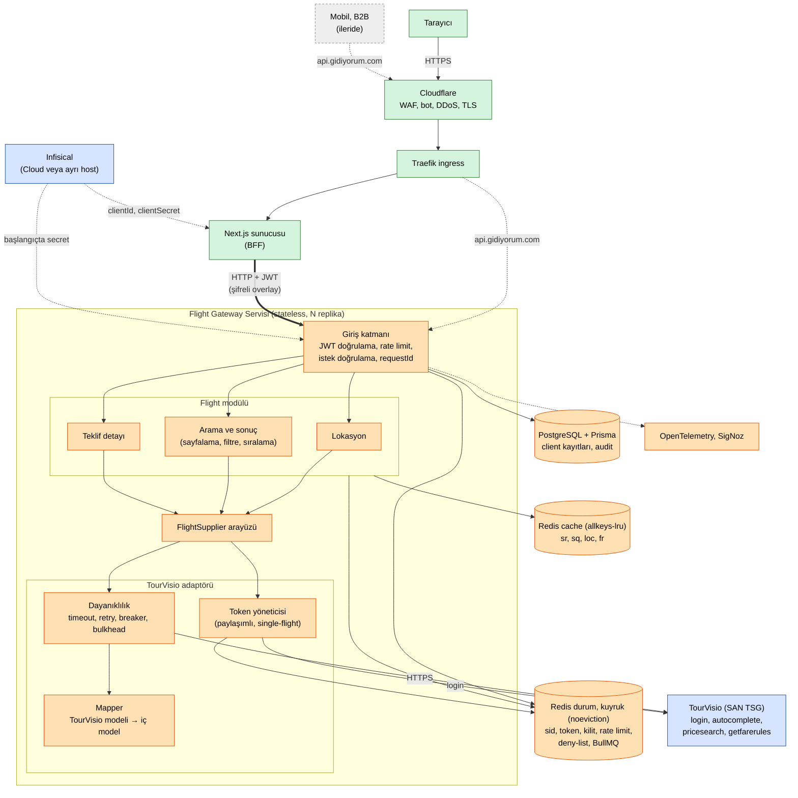
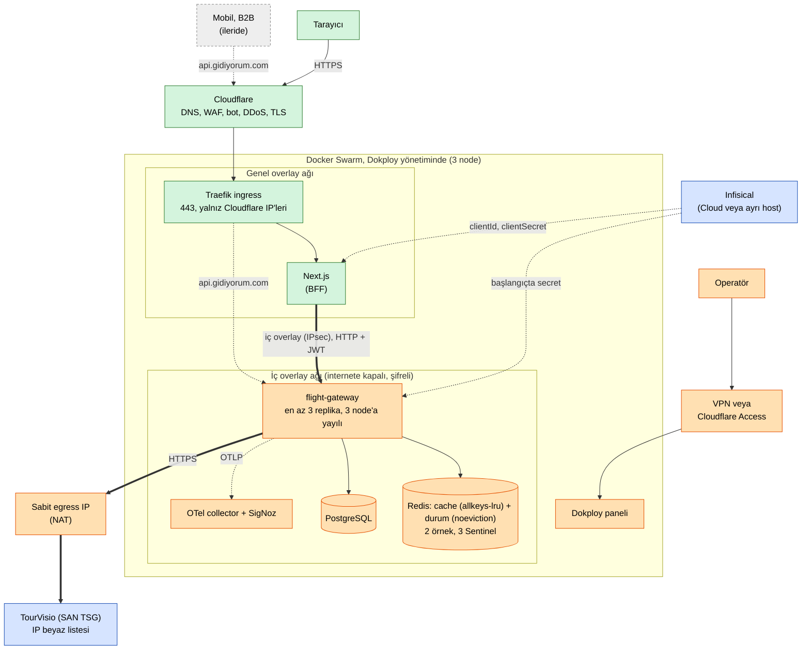
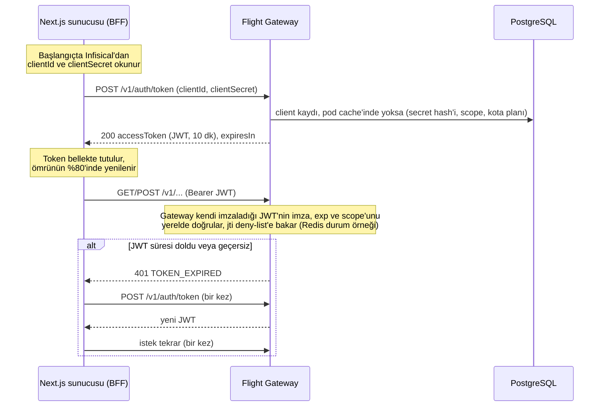
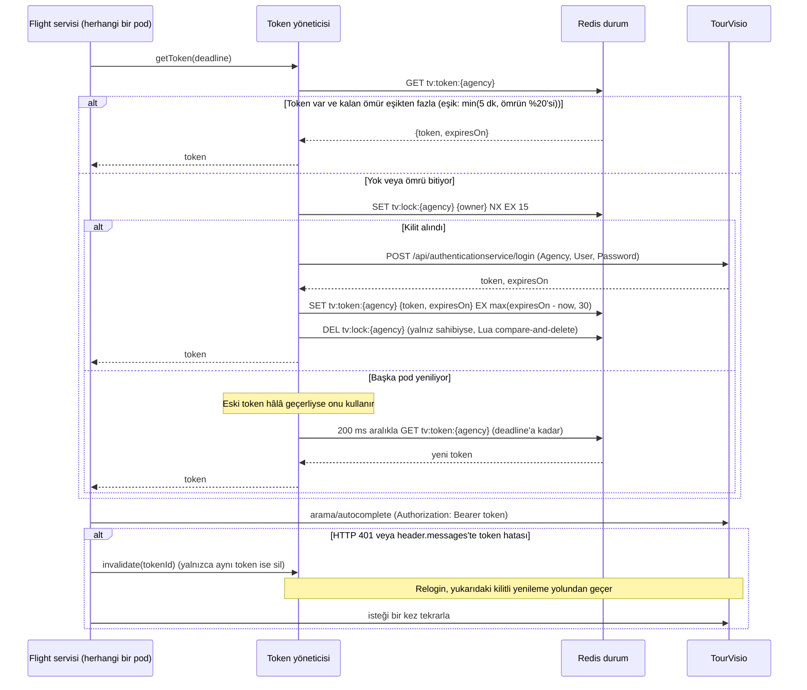
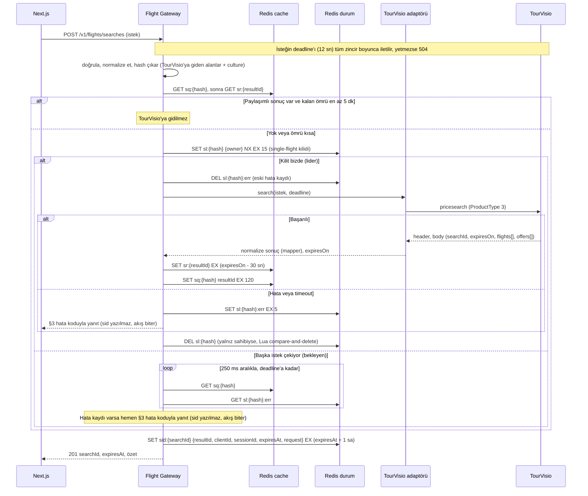
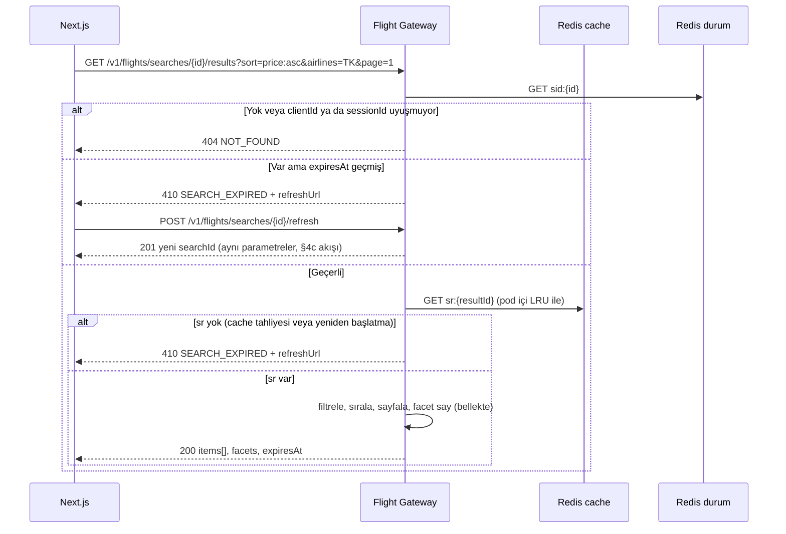
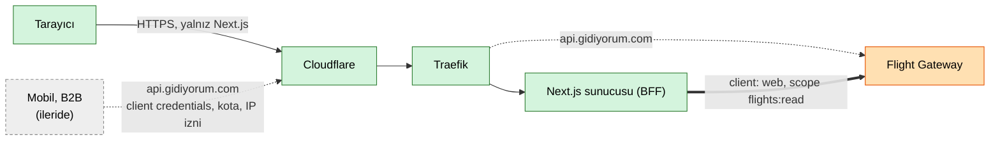

# TourVisio Uçak API Mimari Planı

**Proje:** gidiyorum.com, tedarikçiden bağımsız uçak servisi ("Flight Gateway")
**Kapsam:** Auth, lokasyon arama, uçuş arama, listeleme (sayfalama, sıralama, filtre), teklif detayı. Rezervasyon ve ödeme kapsam dışı (bkz. §8).
**Sürüm:** v1 taslak, 2026-10-21

## Özet

- Tek deploy edilebilir servis (modüler monolit, TypeScript + NestJS). TourVisio adaptörü bir `FlightSupplier` arayüzünün arkasındadır, Next.js TourVisio şemasını görmez.
- Next.js servise kendi sunucusundan bağlanır (BFF). Mobil ve B2B aynı servisi `api.gidiyorum.com` üzerinden, ayrı client kimliğiyle kullanır.
- Darboğaz TourVisio (2-8 sn, kota belirsiz). Token paylaşımlıdır, aynı aramalar tek çağrıya iner (single-flight), sonuç Redis'te `expiresOn`'a kadar tutulur. Sayfalama, filtre ve sıralama bizde yapılır.
- Client'a kendisine bağlı opak bir `searchId` verilir, TourVisio'nunki dışarı çıkmaz. Süre dolunca `410 SEARCH_EXPIRED`, client `/refresh` ile aramayı yeniler.

## 1. Teknoloji seçimi

| Katman | Seçim | Gerekçe |
|---|---|---|
| Dil / framework | TypeScript, Node 22, NestJS (Fastify adapter) | Next.js ekibiyle aynı dil ve tipler. İş yükü I/O ağırlıklı, event loop 2-8 sn bekleyen çok sayıda çağrıyı ucuza taşır. |
| Araç zinciri | pnpm, Biome, zod + `nestjs-zod`, OpenAPI, Docker | zod şemaları hem girdi doğrulamayı hem OpenAPI belgesini üretir (`nestjs-zod`). Next.js tipleri bu belgeden gelir. |
| Veritabanı | PostgreSQL 16 + Prisma. Tek primary, günlük yedek + PITR, managed tercih. | Client kayıtları, API anahtarı özetleri, audit log, ileride rezervasyon. Arama yolu PostgreSQL'e bağlı değildir: düşerse yalnız yeni JWT alınamaz (client kaydı pod içinde 60 sn cache'li). `/health/ready` etkilenmez, metrik ve alarm üretir. |
| Cache | Redis 7, cache örneği (`allkeys-lru`) | `sr`, `sq`, `loc`, `fr` anahtarları. `sr` kaybında client `410` + `/refresh` ile aramayı yeniler. Boyut ≈ benzersiz sonuç/sn × sonuç ömrü × blob boyutu (ölçülecek). |
| Durum / kuyruk | Redis 7, durum örneği (`noeviction`) | `sid` (küçük kayıt), token, kilitler, `sl:*:err`, rate limit sayaçları, `jti` deny-list, BullMQ. İki örnek ayrı instance'tır, ikisi de Sentinel ile (3 sentinel, 3 node'a yayılı) ya da managed Redis olarak çalışır. |
| Kuyruk | BullMQ (Redis durum örneğinde) | Arama akışı istek-yanıt biçimindedir. Bugün yalnız autocomplete ısıtma işi için kullanılır (gece zamanlanmış tek iş). Rezervasyon geldiğinde biletlemede de kullanılacak. |
| Edge | Cloudflare (DNS, WAF, bot yönetimi, DDoS) + Traefik ingress | Bot ve hacimsel saldırı origin'e gelmeden kesilir. Origin yalnız Cloudflare IP aralıklarına açıktır. |
| Gözlem | OpenTelemetry → SigNoz: trace, metrik, log ve hata takibi | `requestId` ve TourVisio `requestId`'si ile trace. OpenTelemetry collector'da PII ve secret maskelenir (attribute processor). |
| Secret | Infisical Cloud (Swarm dışı) ya da ayrı bir host, Swarm node'larıyla aynı yerde değil. Ortam başına proje. | Kimlik bilgileri koda, imaja ve repoya girmez. Container entrypoint `infisical run` (machine identity) ya da Dokploy env senkronu ile enjekte edilir. Infisical erişilemezse çalışan pod'lar etkilenmez, yeni pod başlamaz. |
| Çalışma ortamı | Docker, Dokploy + Docker Swarm (3 node, quorum için) + Traefik. Gateway en az 3 replika. | Servis stateless olduğu için replika eklemek yeterli (bkz. §7). |
| CI | GitHub Actions | Aşağıdaki hat. |

### Ortamlar, CI/CD ve sağlık

- `dev`, `stage`, `prod`; stage TourVisio test ortamına bağlıdır. CI: Biome, test, build, imaj, Dokploy deploy (stage otomatik, prod onaylı), `prisma migrate deploy` deploy adımında.
- `GET /health/live` süreç ayakta mı, `GET /health/ready` yalnız yapılandırmanın yüklendiğini söyler. Redis, PostgreSQL ve TourVisio token durumu `ready`'yi etkilemez (aksi halde bağımlılık kesintisi tüm pod'ları trafikten çıkarır ve degrade yolları çalışamaz), metrik ve alarm üretir.
- OpenAPI belgesi `/v1/openapi.json` adresinden yayınlanır, Next.js tipleri buradan üretilir.

## 2. Mimari şema

> Okuma: yeşil = müşteriye açık yüzey, turuncu = yalnızca iç ağ, mavi = dış servis (tedarikçi, Infisical), gri kesikli = ileride eklenecek.



Tek servis yeterli:

- Sınır modül düzeyindedir. `Flight` iş mantığı yalnız `FlightSupplier` arayüzünü tanır, TourVisio alan adı, enum'u veya hata kodu adaptörün dışına çıkmaz. İkinci tedarikçi yeni bir adaptör demektir, API değişmez.
- Bugün servis bölmenin maliyeti (ağ hop'u, dağıtık hata, ayrı deploy) kazancından büyük: darboğaz CPU değil TourVisio, ekip küçük.
- Bölme tetikleyicileri: rezervasyon ve ödeme gelince `Booking` ayrı servis olur (farklı güvenlik sınıfı, KVKK, ölçek). İkinci tedarikçi trafiği ayrı ölçekleme isterse adaptör ayrılır.
- Ayrı API gateway ürünü yok. Görevini Traefik (TLS, kaba rate limit) ile servisin giriş katmanı (JWT, ince rate limit, doğrulama) üstlenir.

### Dağıtım topolojisi

Gateway bugün internete kapalıdır. Mobil/B2B açıldığında yalnız `api.gidiyorum.com` rotası Traefik üzerinden açılır. Port ve erişim matrisi: [`docs/dagitim-topolojisi.md`](docs/dagitim-topolojisi.md). Etkileşimli 3D sürümü: <https://cihantaylan.com/case/tourvisio/> (kaynağı `topology/`; servis kodu değil, bu şemanın görselleştirme aracıdır).



## 3. Metot planı

Ortak kurallar:

- Taban yol `/v1`. Yanıtlar JSON, hatalar `application/problem+json` (RFC 9457): `{ "type", "title", "status", "code", "detail", "requestId", "supplierRequestId?", "retryAfterSec?", "refreshUrl?" }`.
- `/auth/token` ve `/health/*` hariç her istekte `Authorization: Bearer <JWT>`. Metotlar okuma niteliğindedir. Arama `POST`'u kalıcı iş sonucu doğurmaz, tekrarı zararsızdır, idempotency anahtarı gerekmez.
- Boş sonuç 200 + boş liste döner. İstisna: arama `POST`'u sonuç bulamazsa 201 + `summary.totalOffers: 0`.

### Hata kodları ve TourVisio eşlemesi

Adaptör `header.success=false` ve `header.messages[]` içeriğini aşağıdaki kodlara çevirir. Mesaj metinleri ilk entegrasyonda test hesabıyla doğrulanır (bkz. §10, soru 8).

| HTTP | `code` | Ne zaman |
|---|---|---|
| 400 | `VALIDATION_ERROR` | Şema veya format hatası (tarih formatı, eksik alan) |
| 401 | `TOKEN_INVALID` / `TOKEN_EXPIRED` | JWT yok, bozuk ya da süresi dolmuş |
| 401 | `INVALID_CLIENT` | Hatalı `clientId`/`clientSecret` (yalnız `/auth/token`, mesaj genel tutulur) |
| 403 | `SCOPE_FORBIDDEN` | Client'ın scope'u yok |
| 404 | `NOT_FOUND` | searchId/offerId yok, başka client'a veya başka oturuma ait (varlık sızdırmamak için 403 yerine 404) |
| 410 | `SEARCH_EXPIRED` | `expiresAt` geçmiş veya sonuç Redis'ten düşmüş, `refreshUrl` döner |
| 422 | `BUSINESS_RULE` | Geçmiş tarih, 330 günden ileri tarih, gidiş = varış, dönüş < gidiş, yolcu sayısı sınır dışı |
| 429 | `RATE_LIMITED` | Client/IP kotası aşıldı veya `/auth/token` geçici kilidi, `Retry-After` döner |
| 502 | `SUPPLIER_ERROR` | Bilinmeyen mesaj veya şema dışı gövde. Token hatası (HTTP 401 veya `header.messages`'te token hatası) relogin + 1 tekrardan sonra da sürerse. |
| 502 | `SUPPLIER_REJECTED` | TourVisio doğrulama mesajı (zorunlu alan, geçersiz lokasyon/tarih). Ham mesaj loglanır, kendi doğrulamamızın kaçırdığı durumdur. |
| 503 | `SERVICE_UNAVAILABLE` | Kendi bağımlılığımız (Redis örnekleri, PostgreSQL) erişilemez ya da yük atma, `Retry-After` döner |
| 503 | `SUPPLIER_UNAVAILABLE` | Breaker açık, bulkhead dolu veya TourVisio hız/kota mesajı, `Retry-After` döner |
| 504 | `SUPPLIER_TIMEOUT` | TourVisio zaman aşımı veya istek bütçesi (12 sn) yetmedi |

### Normalize iç veri modeli

Next.js ve `Flight` modülü yalnız bu modeli görür; mapper TourVisio yanıtını buna çevirir.

```ts
interface Location { code: string; name: string; city: string; country: string; type: 'airport' | 'city' }
interface Segment { flightNumber: string; airline: { code: string; name: string }; from: string; to: string;
  departAt: string; arriveAt: string; durationMin: number }       // IATA kodları, ISO 8601 + ofset
interface Leg { direction: 'OUTBOUND' | 'INBOUND'; segments: Segment[]; durationMin: number; stops: number }
interface Flight { flightId: string; legs: Leg[] }
interface Offer {
  offerId: string; flightId: string; supplierRef: string;        // supplierRef dışarı verilmez
  priceBreakdown: { base: number; taxes: number; serviceFee: number; total: number; currency: string };
  baggage: { carryOn: string; checked: string }; cabinClass: string; fareFamily: string; refundable: boolean }
interface SearchResult { resultId: string; expiresAt: string; flights: Flight[]; offers: Offer[] }
```

Prisma modelleri: `ApiClient` (id, clientId, secretHash, scopes, ratePlan, ipAllowlist, status, createdAt) ve `AuditLog` (id, clientId, action, requestId, ipTruncated, at).

### 3.1 Auth

| | |
|---|---|
| Endpoint | `POST /v1/auth/token` |
| Girdi | `{ "clientId": "...", "clientSecret": "...", "scope?": "..." }` (OAuth2 client_credentials mantığı) |
| Çıktı | `{ "accessToken": "<JWT>", "tokenType": "Bearer", "expiresIn": 600, "scope": "flights:read" }` |
| TourVisio çağrısı | Dolaylı: TourVisio token'ı iç TokenManager alır, `POST /api/authenticationservice/login` (bkz. §4b). Bu uç TourVisio token'ını dışarı vermez. |
| Cache | JWT cache'lenmez (imzalı, stateless). `clientId` → secret hash kaydı pod içinde 60 sn LRU. |
| Koruma | IP + `clientId` başına limit, art arda 5 hatada 15 dk geçici kilit (sayaç Redis durum örneğinde). |
| Hatalar | 400, 401 `INVALID_CLIENT`, 429, 503 `SERVICE_UNAVAILABLE` (PostgreSQL erişilemez ve kayıt pod cache'inde yok) |

```json
{ "clientId": "web", "clientSecret": "<clientSecret>", "scope": "flights:read" }
```

```json
{ "accessToken": "<JWT>", "tokenType": "Bearer", "expiresIn": 600, "scope": "flights:read" }
```

### 3.2 Lokasyon arama

| | |
|---|---|
| Endpoint | `GET /v1/locations?type=departure&q=ist&limit=10&culture=tr-TR` (`type`: `departure` veya `arrival`) |
| Girdi | `q` (en az 2 karakter), `type`, `limit` (varsayılan 10, en çok 20), `culture` |
| Çıktı | `{ "items": [ { "code": "IST", "name": "İstanbul Havalimanı", "city": "İstanbul", "country": "TR", "type": "airport" } ], "stale": false }` |
| TourVisio çağrısı | `type=departure` için `getdepartureautocomplete`, `arrival` için `getarrivalautocomplete` (`ProductType: 3`) |
| Cache | Anahtar `loc:{type}:{culture}:{normalize(q)}`, değer tam liste (en çok 20), `limit` yanıtta dilimlenir. Kayıt cache örneğinde 7 gün durur, 24 saatten eskiyse yenilenir. Popüler ~200 havalimanı/şehir önekleri BullMQ'da gece zamanlanmış tek işle, hız sınırlı ısıtılır. |
| Hatalar | 400, 429, 502, 503, 504. Degrade: TourVisio erişilemezse 7 güne kadar eski kayıt döner, gövdede `"stale": true` olur. |

### 3.3 Uçuş arama

| | |
|---|---|
| Endpoint | `POST /v1/flights/searches` |
| Girdi | `tripType` (`ONE_WAY` / `ROUND_TRIP`), `origin`, `destination` (`code` + `type`), `departureDate`, `returnDate?`, `passengers {adult, child, infant}`, `cabin`, `currency`, `culture`, `directOnly?`. Tek yönde `tripType: ONE_WAY` gönderilir ve `returnDate` olmaz; gidiş-dönüş örneği §4d'dedir. |
| Çıktı | 201 Created: arama özeti, `searchId`, `status`, `expiresAt`, `links.results`. `status` şimdilik yalnız `READY` (arama istek-yanıt biçiminde). İlk sayfa gövdede dönmez, client sonuçları listeleme ucundan alır. |
| TourVisio çağrısı | `pricesearch` (`ProductType: 3`, `CheckIn`, `DepartureLocations`, `ArrivalLocations`, `Passengers`). `flightpricesearch` ile farkı açık sorulardadır. |
| Cache | Aşağıdaki anahtarlar: `sr` ve `sq` cache örneğinde, `sid` ve kilit durum örneğinde. |
| Hatalar | 400, 422, 429, 502, 503, 504. Sonuç yok hata değildir: 201 + `summary.totalOffers: 0`. |

Anahtarlar (`expiresAt` = `expiresOn - 30 sn`, client'a bu verilir):

- `sr:{resultId}`: bir TourVisio aramasının normalize sonucu, TTL `expiresOn - 30 sn`.
- `sq:{hash}` → `resultId`: yeni aramalar için paylaşım indeksi, TTL 120 sn, yalnız sonucun kalan ömrü en az 5 dk ise kullanılır. `hash`, TourVisio'ya giden tüm alanlar ve `culture`: `tripType`, `origin`, `destination`, `departureDate`, `returnDate`, `passengers`, `cabin`, `currency`, `culture`, `directOnly`.
- `sid:{searchId}` → `{resultId, clientId, sessionId, expiresAt, request}`: client'a özel işaretçi, durum örneğinde, TTL `expiresAt + 1 sa` (süre dolunca 404 yerine 410 dönmek ve yenileme için). `sr` kaybında 410 + refresh; `sid` durum örneğinde olduğu için tahliye edilmez.
- Aynı anda gelen aynı istekler `sl:{hash}` kilidiyle (durum örneği) tek çağrıya iner (bkz. §4c).
- B2B markup ileride client'a göre uygulanırsa paylaşımlı `sr` üstüne yanıt aşamasında hesaplanır, `sr` içine yazılmaz.

### 3.4 Listeleme (sayfalama, sıralama, filtre)

| | |
|---|---|
| Endpoint | `GET /v1/flights/searches/{searchId}/results?page=1&pageSize=20&sort=price:asc&airlines=TK,PC&maxStops=1&departureFrom=06:00&departureTo=12:00` |
| Girdi | `page` (1 tabanlı), `pageSize` (varsayılan 20, en çok 50), `sort` (`price`, `duration`, `departureTime`; `:asc/desc`), filtreler: `airlines`, `maxStops` (0, 1, 2; her iki bacak için en çok aktarma), `departureFrom` / `departureTo`, `maxPrice?` |
| Kurallar | `departureFrom/To` gidiş bacağının ilk segment kalkış saatidir. `duration` sıralaması gidiş-dönüşte iki bacağın toplamıdır. Her facet, kendi filtresi hariç diğer filtrelere göre sayılır. |
| Çıktı | `items[]`, sayfa bilgisi, `facets`, `appliedFilters`, `expiresAt`, `staleSoon`. Header `X-Search-Expires-In` (saniye). Örnek §4d. |
| TourVisio çağrısı | Yok. Sonuç Redis'te normalize halde durur. |
| Cache | `sid` ile `sr:{resultId}` okunur (gzip blob). Pod içi LRU 30 sn, ayrıştırılmış nesneyi tutar. Filtre ve sıralama bellekte yapılır. |
| Hatalar | 400, 404, 410, 429, 503 |

Yenileme:

| | |
|---|---|
| Endpoint | `POST /v1/flights/searches/{searchId}/refresh` |
| Girdi | Gövde yok. `sid` içindeki `request` ile aynı parametreler kullanılır. |
| Çıktı | 201, yeni `searchId` ve §3.3 yanıtı |
| Koruma | `sessionId` + IP başına limit (ör. aynı arama için dakikada 2) |
| Hatalar | 404 (`sid` silinmiş, client baştan arar), 422, 429, 502, 503, 504 |

### 3.5 Teklif detayı

| | |
|---|---|
| Endpoint | `GET /v1/flights/searches/{searchId}/offers/{offerId}?include=fareRules` |
| Girdi | `searchId`, `offerId` (opak id), `include=fareRules` opsiyonel |
| Çıktı | Segmentler, bagaj (el bagajı `carryOn` + kayıtlı `checked`), `cabinClass` ve `fareFamily`, fiyat kırılımı (taban, vergi, hizmet bedeli, toplam, para birimi), iade/değişiklik özeti, `expiresAt` |
| TourVisio çağrısı | Normalde yok: bagaj, paket ve fiyat kırılımı arama sonucundaki `offers[]` içinden gelir. Yalnız `include=fareRules` ile `getfarerules` çağrılır (`supplierRef` ile). Teklifin geçerliliğini rezervasyon adımı doğrular (bkz. §8). |
| Cache | `getfarerules` yanıtı `fr:{resultId}:{offerId}` (cache örneği), TTL aramanın kalan ömrü. |
| Hatalar | 400, 404, 410, 429, 503. 502, 504 yalnız `fareRules` çağrısında. |

Örnek yanıt (yalnız gidiş segmenti gösterilmiştir). Fiyat: 1650,00 + 380,00 + 120,00 = 2150,00.

```json
{
  "searchId": "s_01KAJ3X9Z7Q8M4N2B6V5C1D0FT", "offerId": "o_3fa92b", "flightId": "f_8c1a",
  "cabinClass": "ECONOMY", "fareFamily": "ECOFLY", "refundable": false,
  "priceBreakdown": { "base": 1650.00, "taxes": 380.00, "serviceFee": 120.00, "total": 2150.00, "currency": "TRY" },
  "baggage": { "carryOn": "8 kg", "checked": "20 kg" },
  "legs": [ { "direction": "OUTBOUND", "durationMin": 95, "stops": 0, "segments": [
    { "flightNumber": "TK2112", "airline": { "code": "TK", "name": "Turkish Airlines" }, "from": "IST", "to": "AYT",
      "departAt": "2026-12-10T07:30:00+03:00", "arriveAt": "2026-12-10T09:05:00+03:00", "durationMin": 95 } ] } ],
  "fareRules": { "refund": "İade edilemez", "change": "600 TRY değişiklik bedeli ve fiyat farkı ile değiştirilebilir" },
  "expiresAt": "2026-10-21T14:15:00Z"
}
```

## 4. Auth ve listeleme akışı

### 4a. Auth, birinci halka: Next.js ↔ bizim servis



- Token Next.js sunucu belleğinde tutulur (modül seviyesinde tek örnek), tarayıcıya ve `NEXT_PUBLIC_*` değişkenine verilmez. Yenilemeden sonra da 401 gelirse Next.js tarayıcıya 502 döner, döngüye girilmez.
- JWT: RS256, `exp` 10 dk, `sub=clientId`, `scope`, `aud=flight-gateway`, `jti`. Gateway kendi imzalar ve yerelde doğrular, JWKS yoktur; anahtar döndürme `kid` ile yapılır. İptal en geç token ömrü kadar (10 dk) gecikir, acil iptal için `jti` Redis deny-list'ine yazılır.

### 4b. Auth, ikinci halka: servis ↔ TourVisio (client görmez)



- Redis değeri `{token, expiresOn}`, TTL `max(expiresOn - now, 30 sn)`. Yenileme eşiği `min(5 dk, ömrün %20'si)` olup uygulama tarafında uygulanır. Kilit sahip değeriyle alınır ve yalnız sahibi tarafından silinir (compare-and-delete). Pod belleğinde yalnız kısa süreli kopya bulunur. Login bilgisi Infisical'dadır.
- Paylaşımlı ve kilitli olmasının nedeni: her pod ayrı login olursa TourVisio bir oturumu diğerinin token'ını düşürebilir ve login'e gereksiz yük biner. Tek yenileyici vardır, diğerleri bekler. Bekleyen pod, eski token hâlâ geçerliyse onu kullanır.
- Login timeout'u 3 sn, backoff'ludur. Üst üste hata olursa `AUTH` breaker'ı açılır, 503 döner. Token bekleme, login ve arama, isteğin 12 sn bütçesinden düşer.

### 4c. Listeleme, birinci aşama: arama



Yeni lider kilidi alınca eski `sl:{hash}:err` kaydını siler. Lider hata alırsa `sl:{hash}:err` yazar (5 sn), bekleyenler 250 ms aralıkla bakar ve hatayı hemen §3 hata koduyla döner. İki durumda da `sid` yazılmaz.

### 4d. Listeleme, ikinci aşama: sayfalama, filtre, sıralama ve `expiresOn`



- Sayfa, filtre ve sıralama değişiklikleri TourVisio'ya gitmez, sayfalar aynı kümeden gelir. Sona 2 dakikadan az kalınca gövdede `"staleSoon": true` döner, Next.js geri sayım ve "fiyatları yenile" düğmesi gösterir.
- Yenileme aynı parametrelerle (önce `sq:{hash}`'e bakarak) yeni `searchId` verir. Filtre ve sıralama URL'de durduğu için yeni `searchId` ile aynen uygulanır.

Örnek istek, arama yanıtı (201) ve listeleme yanıtı (200). `searchId` 26 karakterlik ULID biçimindedir (örnek değer). Facet'ler kuralı gösterir: `airlines` filtresi `TK` iken havayolu facet'i PC ve AJ'yi de sayar, `maxStops=1` iken aktarma facet'i 2'yi de içerir.

```json
{ "tripType": "ROUND_TRIP", "origin": { "code": "IST", "type": "airport" }, "destination": { "code": "AYT", "type": "airport" },
  "departureDate": "2026-12-10", "returnDate": "2026-12-17", "passengers": { "adult": 1, "child": 0, "infant": 0 },
  "cabin": "ECONOMY", "currency": "TRY", "culture": "tr-TR", "directOnly": false }
```

```json
{ "searchId": "s_01KAJ3X9Z7Q8M4N2B6V5C1D0FT", "status": "READY", "createdAt": "2026-10-21T14:00:03Z", "expiresAt": "2026-10-21T14:15:00Z",
  "currency": "TRY", "summary": { "totalOffers": 214, "cheapestTotal": 2150.00, "airlines": ["TK", "PC", "AJ"] },
  "links": { "results": "/v1/flights/searches/s_01KAJ3X9Z7Q8M4N2B6V5C1D0FT/results" } }
```

```json
{ "searchId": "s_01KAJ3X9Z7Q8M4N2B6V5C1D0FT", "page": 1, "pageSize": 20, "totalItems": 38, "totalPages": 2, "sort": "price:asc",
  "expiresAt": "2026-10-21T14:15:00Z", "staleSoon": false,
  "appliedFilters": { "airlines": ["TK"], "maxStops": 1, "departureTime": { "from": "06:00", "to": "12:00" } },
  "facets": { "airlines": [ { "code": "TK", "name": "Turkish Airlines", "count": 38, "minPrice": 2150.00 },
                            { "code": "PC", "name": "Pegasus", "count": 21, "minPrice": 2290.00 }, { "code": "AJ", "name": "AJet", "count": 14, "minPrice": 2410.00 } ],
              "stops": [ { "value": 0, "count": 30 }, { "value": 1, "count": 8 }, { "value": 2, "count": 5 } ], "price": { "min": 2150.00, "max": 6890.00 } },
  "items": [ { "flightId": "f_8c1a", "offerId": "o_3fa92b", "airline": { "code": "TK", "name": "Turkish Airlines" },
    "outbound": { "from": "IST", "to": "AYT", "departAt": "2026-12-10T07:30:00+03:00", "arriveAt": "2026-12-10T09:05:00+03:00", "durationMin": 95, "stops": 0 },
    "inbound": { "from": "AYT", "to": "IST", "departAt": "2026-12-17T18:20:00+03:00", "arriveAt": "2026-12-17T19:55:00+03:00", "durationMin": 95, "stops": 0 },
    "price": { "total": 2150.00, "currency": "TRY" }, "baggage": { "carryOn": "8 kg", "checked": "20 kg" } } ] }
```

Süre dolunca (410) gövde ortak `problem+json` biçimindedir: `"code": "SEARCH_EXPIRED"`, `"refreshUrl": "/v1/flights/searches/s_01KAJ3X9Z7Q8M4N2B6V5C1D0FT/refresh"`.

## 5. Sisteme erişim



Next.js servise sunucudan bağlanır (BFF): tarayıcı route handler'ları çağırır, handler gateway'e gider. Gerekçeler:

1. `clientSecret` ve servis JWT'si tarayıcıya çıkmaz.
2. Next.js, kullanıcı oturumunu (`sessionId`) ve gerçek IP'yi header ile iletir (`X-Client-Session`, `X-Forwarded-For`). Gateway bunları yalnız doğrulanmış client'tan kabul eder.
3. Tarayıcıdan doğrudan bağlanma `clientSecret`'ı açığa çıkarır ya da zayıf, herkese açık bir client gerektirir; reddedildi. CORS yüzeyi oluşmaz ve gateway internete açık kalmaz.
4. Next.js ile gateway arasındaki trafik şifreli Swarm overlay ağındadır (`--opt encrypted`). Gateway'in internete açılma durumu için bkz. §2.

| İstemci | Kimlik | Kota / politika |
|---|---|---|
| Next.js (web) | `client: web`, client credentials, `flights:read` | Next.js'in ilettiği `sessionId` ve IP'ye göre kullanıcı ve IP başına limit |
| Mobil | Mobil BFF (tercih) ya da cihaz kanıtı (Play Integrity / App Attest) + PKCE ile kısa ömürlü token. Gömülü secret yok. | Cihaz/kullanıcı başına limit |
| B2B acente | Acente başına client credentials, IP allowlist, ayrı scope ve plan | Acente başına dakikalık/günlük kota, ayrı markup (ileride) |

B2B markup'ı ileride client'a göre uygulanırsa paylaşımlı `sr` üstüne yanıt aşamasında hesaplanır (bkz. §3.3). Secret'lar Infisical'dadır (bkz. §1). TourVisio bilgisi yalnız gateway servisine verilir, Next.js'in `clientSecret`'ı `NEXT_PUBLIC_` ile başlamaz.

## 6. Güvenlik

| Tehdit | Önlem |
|---|---|
| Bot / scraping | Asıl limit IP başınadır ve Cloudflare bot skoruna bağlıdır (WAF, bot yönetimi). Turnstile, Next.js sunucusunda doğrulanır ve her `POST /searches` için tek kullanımlıktır. Serviste client ve `sessionId` başına dakikalık arama limiti (ör. 10/dk). Autocomplete limiti ör. 60/dk/IP. `/refresh`: `sessionId` + IP başına, aynı arama için dakikada 2. |
| Kimlik bilgisi tahmini | `/auth/token`: IP + `clientId` başına limit, art arda 5 hatada 15 dk geçici kilit. |
| Cache'i atlatıp kota yakma (rastgele rota/tarih ile) | Client + IP başına benzersiz arama limiti (ör. 30/saat/IP), tarih aralığı sınırı (330 gün), olağan dışı çeşitlilikte oturum yavaşlatma. Tekrarlanan sorgular zaten paylaşımlı cache'ten döner. |
| TourVisio kotasının tüketilmesi | Cache + single-flight, bulkhead (pod başına 25 eşzamanlı çağrı, bkz. §7), client başına kota, autocomplete 24 sa cache. Kota metriği ve eşik alarmı. Saldırı altında yalnız cache (degrade) modu. |
| Token sızıntısı | TourVisio token'ı ve kimlik bilgisi dışarı verilmez. Redis'e TLS ve yalnız servis erişimi. Log'larda maskeleme, OpenTelemetry collector'da PII/secret maskeleme (attribute processor), TCKN/pasaport hiçbir span/log'a girmez. JWT 10 dk ömürlü, `kid` ile döndürme, acil iptalde `jti` deny-list (Redis durum örneği kesintisinde fail-open, bilinen risk). CI'da secret taraması (gitleaks). |
| Başkasının `searchId`'sine erişim (IDOR) | `searchId` opak: ULID (80 bit rastgele), tahmin edilemez, ayrıca her okumada sahiplik kontrolü yapılır. Her arama `clientId` + `sessionId` ile bağlıdır, her okumada kontrol edilir, uymazsa 404. `sq` ve `sr` anahtarları dışarı verilmez. |
| Girdi / enjeksiyon | Katı zod şeması, gövde ve parametre boyut sınırı, `pageSize ≤ 50`, bilinmeyen alanlar reddedilir. |
| Tedarikçiye giden veri | Kullanıcı kimliği tedarikçiye iletilmez, yalnız arama parametreleri gider. Log'larda IP kısaltılır, saklama süresi sınırlıdır. |
| Ağ | Gateway internete açık değildir (bkz. §2). Redis ve PostgreSQL de internete açık değildir. Servisler arası trafik şifreli overlay ağda. Dokploy paneli VPN / Cloudflare Access arkasında (matris: `docs/dagitim-topolojisi.md`). |

KVKK (yolcu verisi geldiğinde: TCKN, pasaport):

- Arama katmanında minimum kişisel veri tutulur (kısaltılmış IP, oturum kimliği; kısa saklama), yolcu verisi ayrı `Booking` servisi ve veri deposunda saklanır.
- Yalnız biletleme için gerekli alanlar toplanır. TCKN ve pasaport alan bazlı şifrelenir (zarf şifreleme). KMS anahtarı ve TCKN/pasaport verisi Türkiye bölgesinde tutulur, Infisical yalnız uygulama secret'ları içindir. Veri ekranda maskelenerek gösterilir ve log'a yazılmaz. Süre dolunca silinir veya anonimleştirilir, erişim rol bazlı verilir ve audit'lenir.
- Aydınlatma metni yayınlanır, gereken yerde açık rıza alınır, veri işleyen sözleşmeleri imzalanır. VERBİS'e kayıt, yükümlülük eşiği aşılıyorsa yapılır. Yurt dışı aktarım KVKK m.9'a (2024 değişikliği) göre yürütülür: yeterlilik kararı yoksa uygun güvenceler (ör. standart sözleşme) sağlanır ve Kurul'a bildirilir. Veri tabanları Türkiye bölgesinde barındırılır.
- İhlal bildirimi (72 saat) ve erişim kayıtları için tek sahip atanır.

## 7. Ölçekleme

Varsayım: kampanyada dakikada 3.000 arama = 50 istek/sn, TourVisio yanıtı 2-8 sn. Eşzamanlı çağrı = TourVisio'ya giden istek/sn × yanıt süresi (Little yasası).

| Cache isabeti (paylaşım indeksi + single-flight) | TourVisio'ya arama/sn | Eşzamanlı çağrı, 5 sn | Eşzamanlı çağrı, 8 sn |
|---|---|---|---|
| %0 | 50 | 250 | 400 |
| %30 | 35 | 175 | 280 |
| %60 | 20 | 100 | 160 |

- %60 isabet bir varsayımdır (kampanyada rotalar kümelenir, popüler 20-30 rota); kampanyada ölçülecek.
- Bulkhead pod başına sabit 25 eşzamanlı TourVisio çağrısıdır: arama 20, autocomplete 4, fareRules 1. Toplam = 25 × replika. Fazlası en çok 2 sn kuyrukta bekler, sonra 503 + `Retry-After` döner. Değerler TourVisio kotası netleşince ayarlanır (bkz. §10, soru 2).

| Replika | Toplam slot | Arama slotu | Karşıladığı senaryo |
|---|---|---|---|
| 3 (HA tabanı) | 75 | 60 | Kampanya dışı trafik |
| 6 (kampanya tabanı) | 150 | 120 | 5 sn ve %60 isabet (100) |
| 8 | 200 | 160 | 8 sn ve %60 isabet (160), marjsız |
| 10 | 250 | 200 | 8 sn ve %60 isabet (%25 marjla), 5 sn ve %30 isabet (175) |

Kampanya tabanı 6 replikadır: 5 sn senaryosunu %60 isabette karşılar ve 3 replikalık HA tabanının iki katıdır. 8 replika, 8 sn ve %60 isabette marjsızdır (arama slotu = ihtiyaç), bu yüzden kampanya öncesi 10 replika önerilir. %0 isabette (250 ve 400) ve %30 isabette 8 sn'de (280) talep, 10 replikanın arama slotunu (200) da aşar, o durumda yük atılır.
- Autocomplete: arama başına ~3 sorgu ≈ 150 istek/sn gateway'e gelir, önek cache isabeti %95 ve üstü beklenirse TourVisio'ya ≈ 8/sn gider; 4 slot ile 6 podda bile yeter, 10 replikada marj artar (varsayım, ölçülecek).

| Konu | Karar |
|---|---|
| Stateless | Durum yalnız Redis (iki örnek) ve PostgreSQL'de. Pod öldürmek güvenlidir, oturum yapışkanlığı yok. |
| Yatay ölçek | Swarm'da HPA yok. Kampanya takvimi bilindiği için replika sayısı tepeden önce elle artırılır (Dokploy replika ayarı veya `docker service scale flight-gateway=8`). İzlenen sinyal: eşzamanlı istek ve bulkhead doluluğu. Otomatik ölçek gerekirse ileride Kubernetes HPA. |
| Cache | Cache örneği `allkeys-lru`. Autocomplete 24 sa (stale 7 gün). `sr` = `expiresOn - 30 sn`. `sq` = 120 sn. `sid` = `expiresAt + 1 sa` (durum örneği). `getfarerules` = aramanın kalan ömrü. Pod içi LRU 30 sn. |
| İstek birleştirme | Aynı hash'li aramalar `sl:{hash}` kilidiyle tek çağrıya iner. Lider hata alırsa `sl:{hash}:err` (5 sn) ile bekleyenlere hemen iletir. |
| Timeout | Autocomplete 3 sn, arama 10 sn, login 3 sn. Toplam istek bütçesi (deadline) 12 sn ve çağrı zinciri boyunca iletilir, yetmezse 504. |
| Retry | Arama timeout'unda retry yok (10 sn + tekrar bütçeyi aşar). Yalnız bağlantı hatasında ve hızlı dönen 502/503'te, kalan bütçe yetiyorsa, en çok 1 kez, jitter'lı. Autocomplete 1 kez tekrarlanır. 4xx ve doğrulama hatalarında retry yok. Retry bütçesi: toplam isteğin %10'u. |
| Circuit breaker | Arama, autocomplete ve auth için ayrı. Hata oranı > %50 (30 sn pencere, en az 20 istek) → 30 sn açık → yarı açık deneme. Açıkken cache'ten degrade veya 503. |
| Load shedding | Aşırı yükte 429 `RATE_LIMITED` veya 503 `SERVICE_UNAVAILABLE` + `Retry-After`, kuyruk sınırlıdır. |
| Redis, cache örneği | Sentinel ile failover. Erişilemezse autocomplete doğrudan TourVisio'ya gider (bulkhead'li), arama 503 döner (sonuç saklanamaz). `/health/ready` etkilenmez, pod'lar trafikte kalır. |
| Redis, durum örneği | Kesintide token pod içindeki kopyayla sürer, kilitler pod içi single-flight'a düşer, rate limit pod içi yedek sayaçla çalışır, `jti` deny-list fail-open olur (bilinen risk). `sid` okunamaz/yazılamaz: arama ve listeleme 503 `SERVICE_UNAVAILABLE` döner (404 değil). |

İzlenecek metrikler: istek hızı, hata oranı ve p50/p95/p99 (metot başına), TourVisio gecikmesi ve eşzamanlı çağrı, cache isabeti ve birleştirme oranı, breaker ve bulkhead durumu, login sıklığı, `SEARCH_EXPIRED` oranı.

Alarm örnekleri: PostgreSQL erişilemez, TourVisio token yenilenemiyor, breaker açık > 1 dk, arama p95 > 8 sn, isabet oranı < %30, bulkhead red oranı > %5, art arda 3 login hatası.

## 8. Kapsam dışı: rezervasyon ve ödeme

Rezervasyon geldiğinde seçili `offerId` ile TourVisio'nun `begintransaction` / `setreservationinfo` / `commit` adımları, ödeme ve yolcu verisiyle birlikte ayrı bir `Booking` servisinde (kendi veri deposu, BullMQ ile biletleme, idempotency anahtarı) çalışır; arama servisi değişmez.

## 9. Varsayımlar

1. TourVisio `login` token'ı acente başına üretilir, süresi `expiresOn` ile gelir ve aynı token birden fazla örnekte eşzamanlı kullanılabilir.
2. `pricesearch` tüm sonuç kümesini tek seferde verir (`disablePaging`). Sayfalama, filtre ve sıralama bizde yapılır.
3. Gidiş-dönüş arama tek `pricesearch` isteğidir, yanıtta gidiş ve dönüş birlikte `offers[]` içindedir.
4. `offers[]` bagaj, paket ve fiyat kırılımını taşır. `getfarerules` yalnız iade/değişiklik kuralları içindir.
5. Arama sonuçlarını kullanıcılar arasında paylaşımlı cache'te tutmak lisans açısından serbesttir. `expiresOn` sonrası teklif kullanılamaz, rezervasyon için taze arama gerekir.
6. Tarih ve saat TourVisio'dan yerel saat gelir, biz ISO 8601 + ofsetle döneriz.
7. `offers[]` alan adları örnek amaçlı sadeleştirilmiştir, gerçek eşleme ilk entegrasyonda doğrulanır. Test hesabı olmadan hata kodları dokümandan çıkarılmıştır.
8. Tek canlı bölge (Türkiye). Stage, TourVisio test ortamını kullanır. Gateway'in çıkışı tek sabit IP üzerinden yapılabilir ve TourVisio bu IP'yi beyaz listeye alır.
9. `sr` kaybı (cache tahliyesi veya failover) kabul edilir: client `410` + `/refresh` ile aramayı yeniler. `sid` durum örneğinde (`noeviction`, küçük kayıt) durduğu için tahliye edilmez.

## 10. SAN TSG / TourVisio'ya açık sorular

1. Token ömrü ne kadar ve `expiresOn` sunucu saatine göre mi? Aynı kullanıcıyla ikinci `login` önceki token'ı düşürür mü?
2. Hız ve eşzamanlılık sınırı nedir (saniyelik, dakikalık, eşzamanlı)? Aşılınca hangi HTTP kodu veya `messages[]` döner?
3. `pricesearch` ile `flightpricesearch` farkı nedir, uçak için hangisi önerilir? Gidiş-dönüş tek istekle mi, iki tek yönle mi aranır? `getcheckindates` bu akışta nasıl kullanılır?
4. `expiresOn` neyin geçerlilik sonudur: arama sonucunun, tekliflerin ya da yalnız `searchId`'nin? Rezervasyonda süre bittiyse ne olur? Sonuç aynı `searchId` ile yeniden okunabilir mi?
5. Sonuçları kullanıcılar arasında paylaşımlı cache'lemek lisansa uygun mu, izin verilen azami süre var mı?
6. `acceptPendingProviders` ve kademeli sonuç dönüşü var mı? Yavaş sağlayıcı için nasıl davranmalıyız?
7. Bagaj, paket, vergi kırılımı `offers[]` içinde hangi alanlarda gelir? `getfarerules` zorunlu mu?
8. `header.messages[]` hata kodu kataloğu ve "sonuç yok" ile "hata" ayrımı için belge var mı?
9. Test ve canlı ortam adresleri, IP beyaz liste (tek sabit egress IP yeterli mi) ve test verisi nasıl sağlanır?
10. Hizmet bedeli, komisyon ve markup nerede hesaplanır? SLA, planlı bakım penceresi ve durum sayfası var mı?

## 11. Süre ve yapay zekâ kullanımı

- Harcanan süre: 1 saat
- Araçlar: Topoloji ve şemalarda kendi topoloji şablonumu ve daha büyük mimariler için tasarladığım topoloji görselleştirme aracımı kullandım (etkileşimli 3D harita: `topology/`).
- Yapay zekâ kullanımı: Claude Code ile taslak metni, Mermaid şemalarını ve metin düzenini hazırladım. Mimari kararları, varsayımları ve açık soruları gözden geçirip son hâline getirdim; TourVisio uç adlarını ödev dokümanıyla karşılaştırdım.
- Şema kaynakları `docs/diagrams/` altında repoda durur.
