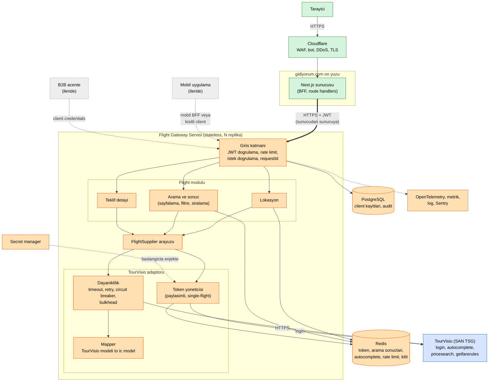
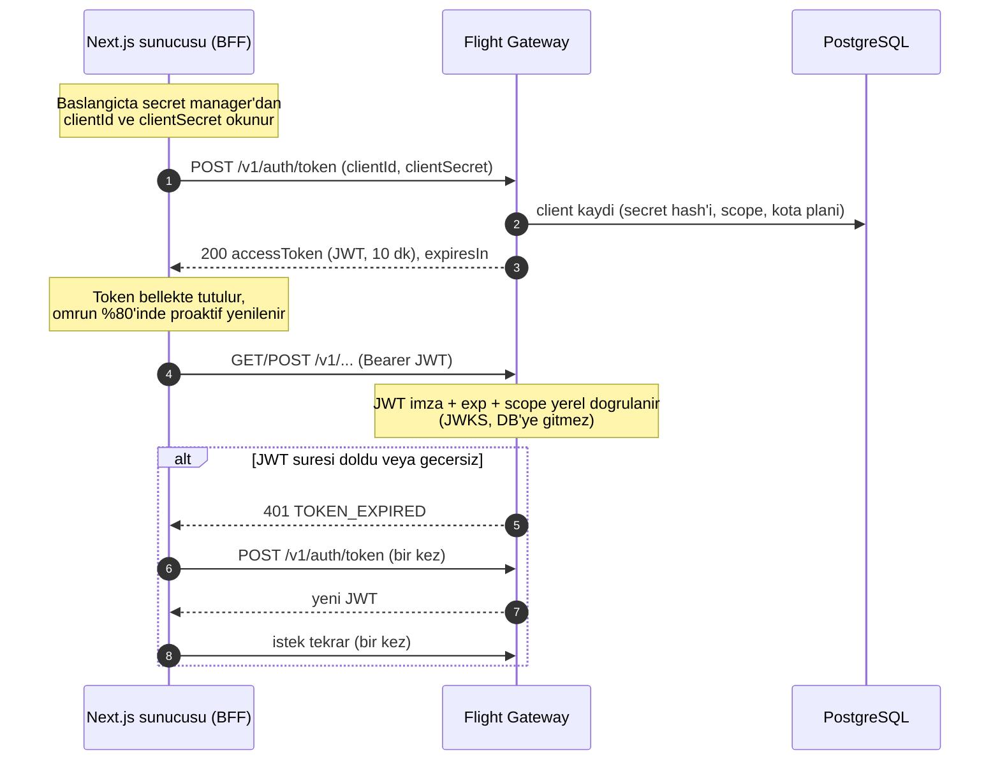
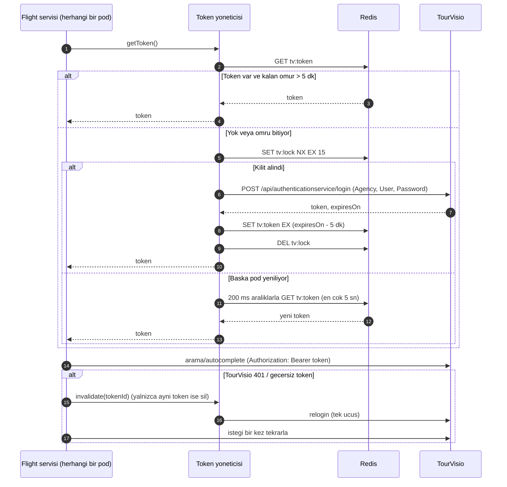
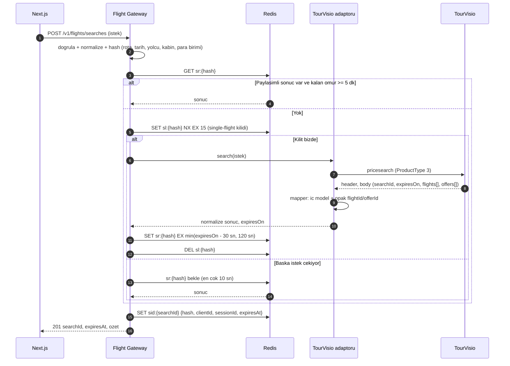
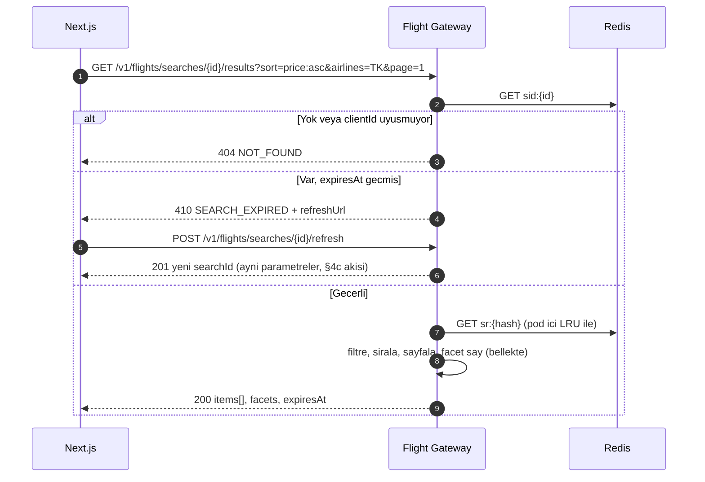
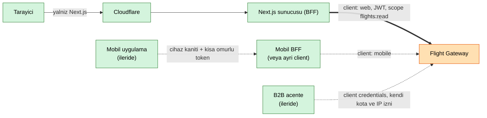

# TourVisio Uçak API Mimari Planı

**Proje:** gidiyorum.com, tedarikçiden bağımsız uçak servisi ("Flight Gateway")
**Kapsam:** Auth, lokasyon arama, uçuş arama, listeleme (sayfalama, sıralama, filtre), teklif detayı. Rezervasyon ve ödeme kapsam dışı (bkz. §8).
**Sürüm:** v1 taslak, 2026-10-21

## TL;DR

- **Tek deploy edilebilir servis** (modüler monolit, TypeScript + NestJS). İçinde `Flight` modülü ve **TourVisio adaptörü**; adaptör bir `FlightSupplier` arayüzünün arkasında, Next.js asla TourVisio şemasını görmez.
- **Next.js servise kendi sunucusundan bağlanır (BFF).** Tarayıcı bizim servisle doğrudan konuşmaz. Mobil ve B2B için aynı servis, farklı client kimliği ile.
- **Darboğaz TourVisio** (2-8 sn, kota belirsiz). Tüm tasarım bunu korur: token tek yerde ve paylaşımlı, aynı aramalar birleştirilir (single-flight), sonuç Redis'te `expiresOn`'a kadar tutulur, sayfalama/filtre/sıralama **bizim tarafta** yapılır, TourVisio'ya tekrar gidilmez.
- **İki searchId:** TourVisio'nun `searchId`'si dışarı çıkmaz. Client'a kendisine bağlı opak bir `searchId` verilir (başkasının aramasına erişim engellenir).
- `expiresOn` dolunca **410 Gone + `SEARCH_EXPIRED`**, client tek çağrıyla (`/refresh`) aramayı aynı parametrelerle yeniler.

---

## 1. Teknoloji seçimi

| Katman | Seçim | Gerekçe (tek cümle) |
|---|---|---|
| Dil / framework | **TypeScript, Node 22, NestJS (Fastify adapter)** | Next.js ekibiyle aynı dil ve tipler (OpenAPI/zod şemaları paylaşılır); iş yükü I/O ağırlıklı olduğu için Node'un event loop'u 2-8 sn'lik bekleyen binlerce çağrıyı ucuza taşır. |
| Veritabanı | **PostgreSQL 16** | Client/acente kayıtları, API anahtarı özetleri, audit log ve ileride rezervasyon verisi için ilişkisel, transaction'lı bir kaynak gerekir. Arama sonuçları buraya **yazılmaz**. |
| Cache / geçici durum | **Redis 7** (managed, replika + otomatik failover) | TourVisio token'ı, arama sonuçları, autocomplete cache'i, rate limit sayaçları ve single-flight kilitleri tek ortak, TTL'li, hızlı bir depoda durur; servis stateless kalır. |
| Kuyruk | **Şimdilik yok.** Rezervasyonda **BullMQ (Redis üstünde)** | Arama akışı senkron; kuyruğa ihtiyaç duyan iş (biletleme, e-posta, webhook) rezervasyonla gelir, yeni altyapı bugün eklenmez. |
| Edge | **Cloudflare (WAF, bot yönetimi, DDoS)** + ingress | Bot ve hacimsel saldırıyı origin'e gelmeden keser; origin yalnızca Cloudflare IP aralıklarından erişilebilir. |
| Gözlem | **OpenTelemetry → Grafana/Loki/Tempo (veya SigNoz), Sentry** | Her istekte `requestId` ve TourVisio `requestId`'si ile trace; metrik ve log aynı kimlikle bağlanır. |
| Secret | **Cloud secret manager** (ortam başına) | TourVisio kimlik bilgileri koda, imaja ve repoya girmez; pod başlarken ortama enjekte edilir, döndürülebilir. |
| Çalışma ortamı | **Container, en az 3 replika, 2 AZ**, yatay otomatik ölçekleme | Stateless olduğu için pod eklemek yeterli. |

---

## 2. Mimari şema

> Okuma: yeşil = müşteriye açık yüzey, turuncu = yalnızca iç ağ, mavi = dış tedarikçi. Kesikli oklar bugün olmayan, sonradan eklenecek parçalar.



**Tek servis mi, birkaç servis mi? Tek servis.**

- Sınır **modül** düzeyinde: `Flight` iş mantığı, `FlightSupplier` arayüzünün arkasındaki `TourVisioAdapter`'ı tanır; adaptörün dışına TourVisio alan adı, enum'u veya hata kodu sızmaz. İkinci bir tedarikçi gelirse yeni bir adaptör yazılır, `Flight` modülü ve API değişmez.
- Servis bölmenin bugünkü maliyeti (ağ hop'u, dağıtık hata, ayrı deploy) kazancından büyük: darboğaz CPU değil TourVisio, ekip küçük, tek yazma yolu var.
- **Bölme tetikleyicileri:** (1) rezervasyon/ödeme gelince `Booking` ayrı servis olur (farklı güvenlik sınıfı, PCI/KVKK, farklı ölçek), (2) ikinci tedarikçi trafiği adaptörü ayrı ölçeklemeyi gerektirirse adaptör `supplier-adapter` olarak ayrılır.
- **API gateway ayrı bir ürün değil:** ingress (TLS, kaba rate limit) + servisin giriş katmanı (JWT, ince rate limit, doğrulama). Ayrı gateway ürünü şu an yalnızca bir hop daha ekler.

---

## 3. Metot planı

Ortak kurallar:

- Taban yol `/v1`. Yanıtlar JSON; hatalar `application/problem+json` (RFC 9457): `{ "type", "title", "status", "code", "detail", "requestId", "supplierRequestId?", "retryAfterSec?" }`.
- Her istekte `Authorization: Bearer <JWT>`. Tüm metotlar okuma niteliğindedir; arama `POST` olsa da yan etkisizdir, idempotency anahtarı gerekmez.
- Boş sonuç **200 + boş liste**, 404 değil.

### Ortak hata tablosu

| HTTP | `code` | Ne zaman |
|---|---|---|
| 400 | `VALIDATION_ERROR` | Şema/format hatası (tarih formatı, eksik alan) |
| 401 | `TOKEN_INVALID` / `TOKEN_EXPIRED` | JWT yok, bozuk ya da süresi dolmuş |
| 403 | `SCOPE_FORBIDDEN` | Client'ın scope'u yok |
| 404 | `NOT_FOUND` | searchId/offerId yok **veya başka client'a ait** (varlık sızdırmamak için 403 değil 404) |
| 410 | `SEARCH_EXPIRED` | `expiresOn` dolmuş, `refreshUrl` döner |
| 422 | `BUSINESS_RULE` | Geçmiş tarih, gidiş = varış, dönüş < gidiş, yolcu sayısı sınır dışı |
| 429 | `RATE_LIMITED` | Client/IP kotası aşıldı, `Retry-After` döner |
| 502 | `SUPPLIER_ERROR` | TourVisio `header.success=false` veya beklenmeyen şema |
| 503 | `SUPPLIER_UNAVAILABLE` | Circuit breaker açık / bulkhead dolu, `Retry-After` döner |
| 504 | `SUPPLIER_TIMEOUT` | TourVisio zaman aşımı |

### 3.1 Auth

| | |
|---|---|
| Endpoint | `POST /v1/auth/token` |
| Girdi | `{ "clientId": "...", "clientSecret": "..." }` (OAuth2 client_credentials mantığı), `scope` opsiyonel |
| Çıktı | `{ "accessToken": "<JWT>", "tokenType": "Bearer", "expiresIn": 600, "scope": "flights:read" }` |
| TourVisio çağrısı | **Yok.** TourVisio token'ı bu uçtan dönmez, içeride kalır (bkz. §4a, §4b). |
| Cache | JWT cache'lenmez (stateless, imzalı). `clientId` → hash'lenmiş secret kaydı pod içinde 60 sn LRU. |
| Hatalar | 400 (eksik alan), 401 `INVALID_CLIENT` (hatalı kimlik, mesaj genel tutulur), 429 (brute force) |

### 3.2 Lokasyon arama

| | |
|---|---|
| Endpoint | `GET /v1/locations?type=departure&q=ist&limit=10&culture=tr-TR` (`type`: `departure` veya `arrival`) |
| Girdi | `q` (en az 2 karakter), `type`, `limit` (varsayılan 10, en çok 20), `culture` |
| Çıktı | `{ "items": [ { "code": "IST", "name": "Istanbul Havalimani", "city": "Istanbul", "country": "TR", "type": "airport" } ] }` (şehir ve havalimanı ayrı `type`) |
| TourVisio çağrısı | `type=departure` için `getdepartureautocomplete`, `arrival` için `getarrivalautocomplete` (`ProductType: 3`) |
| Cache | Redis, anahtar `loc:{type}:{culture}:{normalize(q)}`, **TTL 24 saat**. Üstünde istek birleştirme. İlk 2-3 harf önekleri açılışta ısıtılır. Cache hiti TourVisio'ya gitmez. |
| Hatalar | 400 (`q` kısa), 429, 502/504 (TourVisio). **Degrade:** TourVisio erişilemezse eski cache (stale-if-error, 7 gün) döner, `Warning` header'ı ile. |

### 3.3 Uçuş arama

| | |
|---|---|
| Endpoint | `POST /v1/flights/searches` |
| Girdi | `tripType` (`ONE_WAY` / `ROUND_TRIP`), `origin`, `destination` (`code` + `type`), `departureDate`, `returnDate?`, `passengers {adult, child, infant}`, `cabin`, `currency`, `culture`, `directOnly?` |
| Çıktı | **201**: ilk sayfa değil, arama özeti + `searchId` + `expiresAt` + `links.results`. (Tek round-trip için `?include=firstPage` ile ilk sayfa da döner.) |
| TourVisio çağrısı | `pricesearch` (`ProductType: 3`, `CheckIn`, `DepartureLocations`, `ArrivalLocations`, `Passengers`). `flightpricesearch` ile farkı açık sorulardadır. Arka planda gerekirse önce token yönetici çalışır. |
| Cache | **İki katman.** (1) **Paylaşımlı sonuç:** normalize edilmiş istek parmak izi (rota, tarih, yolcu, kabin, para birimi) → `sr:{hash}`, TTL = `min(expiresOn - 30 sn, 120 sn)`. Cache'ten **yalnızca kalan ömrü ≥ 5 dk ise** servis edilir (kullanıcıya hemen süresi dolacak sonuç verilmez). (2) **Kullanıcıya özel işaretçi:** `sid:{searchId}` → `{hash, clientId, sessionId, expiresAt}`. Aynı anda gelen aynı istekler **single-flight** ile tek TourVisio çağrısına iner (Redis kilidi + bekleyenler sonucu bekler). |
| Hatalar | 400, 422 (`BUSINESS_RULE`), 429, 502 `SUPPLIER_ERROR`, 503 (breaker açık/bulkhead dolu), 504 (zaman aşımı, 10 sn). Sonuç yok = 201 + `totalOffers: 0`. |

### 3.4 Listeleme (sayfalama, sıralama, filtre)

| | |
|---|---|
| Endpoint | `GET /v1/flights/searches/{searchId}/results?page=1&pageSize=20&sort=price:asc&airlines=TK,PC&maxStops=1&departureFrom=06:00&departureTo=12:00` |
| Girdi | `page` (1 tabanlı), `pageSize` (en çok 50), `sort` (`price`, `duration`, `departureTime`; `:asc/desc`), filtreler: `airlines`, `maxStops` (0, 1, 2), `departureFrom` / `departureTo` (aktarmasız gidiş saati), `maxPrice?` |
| Çıktı | `items[]`, sayfa bilgisi, `facets` (havayolu, aktarma, fiyat aralığı sayıları, **mevcut filtreye göre**), `appliedFilters`, `expiresAt` (örnek §4d) |
| TourVisio çağrısı | **Yok.** Sonuç Redis'te zaten normalize halde durur. |
| Cache | Normalize sonuç kümesi Redis'te gzip blob; pod içi LRU (30 sn) ile ayrıştırma maliyeti düşer. Filtre + sıralama bellekte, ≤ birkaç bin teklif için ms düzeyinde. |
| Hatalar | 400 (bilinmeyen sort/filtre), 404, 410 `SEARCH_EXPIRED` (+ `refreshUrl`), 429 |

Yenileme: `POST /v1/flights/searches/{searchId}/refresh` aynı parametrelerle yeni arama başlatır ve **yeni `searchId`** döner (eski id'nin istek özeti 1 saat tutulur). Hatalar 3.3 ile aynı, ayrıca 404 (özet de silinmişse, client baştan arar).

### 3.5 Teklif detayı

| | |
|---|---|
| Endpoint | `GET /v1/flights/searches/{searchId}/offers/{offerId}?include=fareRules` |
| Girdi | `searchId`, `offerId` (bizim opak id'miz), `include=fareRules` opsiyonel |
| Çıktı | Segmentler, bagaj (el + kabin/check-in), paket/kabin sınıfı, **fiyat kırılımı** (taban, vergi, hizmet bedeli, toplam, para birimi), iade/değişiklik özeti, `expiresAt` |
| TourVisio çağrısı | Normalde **yok**: bagaj, paket ve fiyat kırılımı arama sonucundaki `offers[]` içinden gelir. Yalnızca `include=fareRules` istenirse `getfarerules` (ilgili TourVisio offer id'si ile) çağrılır. Seçili teklifin hâlâ geçerli olduğunu sonraki aşamada rezervasyon adımı doğrular (bkz. §8). |
| Cache | `getfarerules` yanıtı `fr:{tvOfferId}`, TTL = aramanın kalan ömrü (fiyat/kural arama bağlamına bağlı). Detay için TourVisio çağrısı gerekmediğinden okuma maliyeti sıfır. |
| Hatalar | 404 (searchId/offerId yok veya başka client'a ait), 410 (arama süresi dolmuş), 502/504 (yalnız fareRules çağrısında) |

---

## 4. Auth ve listeleme akışı

### 4a. Auth, birinci halka: Next.js ↔ bizim servis



- **Nerede saklanır:** Next.js sunucu belleğinde (modül seviyesinde tek örnek). Tarayıcıya, cookie'ye, `NEXT_PUBLIC_*` değişkenine **asla** gitmez.
- **Süre dolunca:** %80'de proaktif yenileme; yine de 401 gelirse tek seferlik yenile + tekrar dene. İki denemede olmazsa 5xx döner, döngüye girilmez.
- JWT: RS256, `exp` 10 dk, `sub=clientId`, `scope`, `aud=flight-gateway`. Anahtar döndürme `kid` + JWKS ile.

### 4b. Auth, ikinci halka: servis ↔ TourVisio (client görmez)



- **Nerede saklanır:** Redis'te `tv:token` (TTL = `expiresOn − 5 dk`). Pod belleğinde yalnız kısa süreli kopya. Login bilgisi (`Agency, User, Password`) secret manager'da.
- **Neden paylaşımlı + kilit:** her pod ayrı login olursa TourVisio tarafı bir oturumu diğerinin tokenını düşürebilir ve login'e yük biner. Tek yenileyici, diğerleri bekler (**single-flight**).
- Login için ayrı küçük timeout (3 sn) ve backoff; üst üste hata → breaker `AUTH` açılır, 503 döner.

### 4c. Listeleme, birinci aşama: arama



### 4d. Listeleme, ikinci aşama: sayfalama, filtre, sıralama ve `expiresOn`



**Davranış özeti**

- Sayfa değiştirme ve filtre/sıralama **TourVisio'ya gitmez**; aynı arama sonucunda sayfa 2 ile sayfa 1 tutarlıdır (aynı küme).
- Yanıt `expiresAt` ve `X-Search-Expires-In` taşır. Sona **2 dakikadan az** kaldıysa gövdede `"staleSoon": true`; Next.js kullanıcıya geri sayım ve "fiyatları yenile" gösterir.
- **Süresi dolunca:** 410 + `refreshUrl`. Yenileme aynı parametrelerle (paylaşımlı cache'e önce bakarak) yeni `searchId` verir; filtre/sıralama Next.js tarafında URL'de durduğu için yeni `searchId` ile aynen uygulanır.

**Örnek istek**

```json
{
  "tripType": "ROUND_TRIP",
  "origin": { "code": "IST", "type": "airport" },
  "destination": { "code": "AYT", "type": "airport" },
  "departureDate": "2026-12-10",
  "returnDate": "2026-12-17",
  "passengers": { "adult": 1, "child": 0, "infant": 0 },
  "cabin": "ECONOMY",
  "currency": "TRY",
  "culture": "tr-TR",
  "directOnly": false
}
```

**Örnek yanıt, arama (201)**

```json
{
  "searchId": "s_01JBX7R4Q9",
  "status": "READY",
  "createdAt": "2026-10-21T14:00:03Z",
  "expiresAt": "2026-10-21T14:15:00Z",
  "currency": "TRY",
  "summary": { "totalOffers": 214, "cheapestTotal": 2150.00, "airlines": ["TK", "PC", "AJ"] },
  "links": { "results": "/v1/flights/searches/s_01JBX7R4Q9/results" }
}
```

**Örnek yanıt, listeleme (200)**

```json
{
  "searchId": "s_01JBX7R4Q9",
  "page": 1,
  "pageSize": 20,
  "totalItems": 38,
  "totalPages": 2,
  "sort": "price:asc",
  "appliedFilters": { "airlines": ["TK"], "maxStops": 1, "departureTime": { "from": "06:00", "to": "12:00" } },
  "expiresAt": "2026-10-21T14:15:00Z",
  "staleSoon": false,
  "facets": {
    "airlines": [ { "code": "TK", "name": "Turkish Airlines", "count": 38, "minPrice": 2150.00 } ],
    "stops": [ { "value": 0, "count": 30 }, { "value": 1, "count": 8 } ],
    "price": { "min": 2150.00, "max": 6890.00 }
  },
  "items": [
    {
      "flightId": "f_8c1a",
      "offerId": "o_3fa92b",
      "airline": { "code": "TK", "name": "Turkish Airlines" },
      "outbound": {
        "departure": { "airport": "IST", "at": "2026-12-10T07:30:00+03:00" },
        "arrival": { "airport": "AYT", "at": "2026-12-10T09:05:00+03:00" },
        "durationMin": 95,
        "stops": 0
      },
      "inbound": {
        "departure": { "airport": "AYT", "at": "2026-12-17T18:20:00+03:00" },
        "arrival": { "airport": "IST", "at": "2026-12-17T19:55:00+03:00" },
        "durationMin": 95,
        "stops": 0
      },
      "price": { "total": 2150.00, "currency": "TRY" },
      "baggage": { "checked": "20 kg", "cabin": "8 kg" }
    }
  ]
}
```

**Örnek yanıt, süre doldu (410)**

```json
{
  "type": "https://api.gidiyorum.com/problems/search-expired",
  "title": "Arama suresi doldu",
  "status": 410,
  "code": "SEARCH_EXPIRED",
  "detail": "Fiyatlar guncel degil, aramayi yenileyin.",
  "requestId": "req_7d2e91",
  "refreshUrl": "/v1/flights/searches/s_01JBX7R4Q9/refresh"
}
```

---

## 5. Sisteme erişim

> Okuma: tarayıcı yalnız Next.js'e konuşur. Bizim servise erişen tek istemci Next.js'in sunucusudur (BFF).



**Next.js nasıl bağlanır (BFF).** Tarayıcı Next.js route handler'larını çağırır; handler sunucudan servise gider. Gerekçe: (1) `clientSecret` ve servis JWT'si tarayıcıya çıkmaz, (2) kullanıcı oturumu (`sessionId`) ve gerçek IP'yi güvenilir biçimde biz ilettiririz (`X-Client-Session`, `X-Forwarded-For` yalnızca doğrulanmış client'tan kabul), (3) CORS yüzeyi yoktur, (4) servisin kamuya açık tek kapısı yoktur, saldırı yüzeyi küçülür. Tarayıcıdan doğrudan bağlanma seçeneği `clientSecret`'ı açığa çıkarır ya da herkese açık, zayıf bir client gerektirir; bu yüzden reddedildi.

**Gelecekte erişim modeli değişimi**

| İstemci | Kimlik | Kota / politika |
|---|---|---|
| Next.js (web) | `client: web`, client credentials, `flights:read` | Kullanıcı başına ve IP başına limit (Next.js iletilen `sessionId` ve IP ile) |
| Mobil | Mobil BFF (tercih) ya da cihaz kanıtı (Play Integrity / App Attest) + PKCE ile kısa ömürlü token; gömülü secret **yok** | Cihaz/kullanıcı başına limit |
| B2B acente | Acente başına `client credentials`, IP allowlist, ayrı scope ve ücretlendirme planı | Acente başına günlük/dakikalık kota, ayrı markup (ileride) |

**Secret'lar nerede.**

| Secret | Yer | Not |
|---|---|---|
| TourVisio `Agency/User/Password` | Cloud secret manager, yalnız `flight-gateway` pod'una | Koda/imaja/repoya girmez, döndürülebilir |
| Servis JWT imza anahtarı | Secret manager / KMS, `kid` ile döndürme | Public key JWKS ile paylaşılır |
| Next.js `clientSecret` | Next.js ortamı için secret manager | `NEXT_PUBLIC_` ile **başlamaz** |
| DB / Redis parolaları | Secret manager, pod başlarken enjekte | Loglanmaz |

---

## 6. Güvenlik

| Tehdit | Somut önlem |
|---|---|
| **Bot / scraping** (fiyat toplama, arama taraması) | Cloudflare WAF + bot yönetimi ve rate limit kuralları; Next.js'te Turnstile (arama formu); servis tarafında client ve `sessionId` başına dakikalık arama limiti (ör. 10/dk/oturum); olağan dışı çeşitlilikte tarama tespit edilince oturum yavaşlatılır; aynı rota/tarih sorgusu zaten paylaşımlı cache'ten döndüğü için taramanın tedarikçi maliyeti düşer. |
| **TourVisio kotasının tüketilmesi** | Arama sonuçları cache + single-flight (aynı sorgu = tek TourVisio çağrısı); **bulkhead:** TourVisio'ya en fazla N eşzamanlı çağrı, sonrası 503 + `Retry-After`; client başına kota; autocomplete 24 saat cache + istemcide debounce ve en az 2 karakter; kota kullanım metriği ve eşik alarmı; saldırı altında "yalnız cache" (degrade) moduna geçiş. |
| **Token sızıntısı** | TourVisio token'ı ve kimlik bilgisi **hiç dışarı çıkmaz**; Redis'te şifreli bağlantı (TLS) ve ağ erişimi yalnız servise; log'larda token/secret maskeleme; JWT kısa ömürlü (10 dk), `kid` ile döndürme, şüphede client'ı iptal; secret manager'dan döndürme prosedürü; repoda secret taraması (gitleaks) CI'da. |
| **Başkasının `searchId`'sine erişim (IDOR)** | `searchId` opak ve tahmin edilemez (ULID + HMAC/rastgele bileşen); her arama `clientId` + `sessionId` ile **bağlıdır** ve her okumada kontrol edilir; uymazsa **404** (varlık sızdırılmaz); paylaşımlı sonuç hash'i dışarı verilmez. |
| **Girdi / enjeksiyon / büyük istek** | Katı şema doğrulama (zod), gövde ve parametre boyut sınırı, `pageSize ≤ 50`, bilinmeyen alanları reddet. |
| **Tedarikçiye giden veri** | Kullanıcı kimliği tedarikçiye iletilmez (yalnız arama parametreleri); log'larda IP kısaltma/hash, saklama süresi sınırlı. |

**KVKK yaklaşımı (yolcu verisi geldiğinde: TCKN, pasaport).**

- Yolcu verisi ayrı servis ve ayrı veri deposunda (`Booking`), arama servisine **girmez**; arama katmanı kişisel veri tutmaz (yalnız kısaltılmış IP/oturum kimliği, kısa saklama).
- **Veri minimizasyonu ve amaç sınırı:** yalnızca biletleme için gerekli alanlar; TCKN/pasaport **alan bazlı şifrelenir** (KMS ile zarf şifreleme), ekranda maskeli gösterilir, **hiçbir log'a yazılmaz**.
- **Saklama süresi ve imha:** işlem sonrası yasal süre dolunca silinir/anonimleştirilir; erişim rol bazlı ve kayıtlıdır (audit).
- **Hukuki:** aydınlatma metni ve gerekli yerde açık rıza, VERBİS kaydı, havayolu/tedarikçiyle veri işleyen sözleşmesi; yurt dışına aktarım (KVKK m.9) için sözleşme ve rıza yolları netleştirilir; veri tabanları Türkiye bölgesinde barındırılır.
- İhlal bildirim prosedürü (72 saat) ve erişim kayıtları için tek sahip belirlenir.

---

## 7. Ölçekleme

**Varsayım:** kampanyada dakikada 3.000 arama = **50 istek/sn**, TourVisio yanıtı 2-8 sn.

- **Hesap (Little yasası):** cache olmadan eşzamanlı TourVisio çağrısı ≈ 50 × 5 sn = **250** (8 sn'de 400). Bu hem bizim bağlantı havuzumuz hem TourVisio tarafı için riskli.
- **Cache ve birleştirme etkisi:** kampanyada rotalar kümelenir (popüler 20-30 rota). %60 isabetle TourVisio'ya ≈ 20 istek/sn, eşzamanlı ≈ 100. Hedef: **bulkhead 150 eşzamanlı çağrı** ve üstünde kuyrukta en çok 2 sn bekleme, sonra 503 + `Retry-After`.
- **Kota:** TourVisio'nun saniyelik/eşzamanlı sınırı bilinmiyor (açık soru), bulkhead değeri kota yanıtına göre ayarlanır.

| Konu | Karar |
|---|---|
| Stateless | Durum yalnız Redis/Postgres'te; pod öldürmek güvenli; oturum yapışkanlığı yok |
| Yatay ölçek | HPA: CPU + **uçuştaki istek sayısı**; en az 3 replika, 2 AZ; Node pod'u binlerce bekleyen bağlantıyı taşır |
| Cache | Autocomplete 24 sa; arama sonucu `min(expiresOn − 30 sn, 120 sn)`; getfarerules aramanın kalan ömrü |
| İstek birleştirme | Aynı parmak izli aramalar tek çağrıya iner (Redis kilidi) |
| Timeout | Autocomplete 3 sn, arama 10 sn, login 3 sn; toplam istek bütçesi 12 sn |
| Retry | Yalnız **idempotent** okumalarda, en çok 1 tekrar, jitter'lı; 4xx ve doğrulama hatalarında yok; retry bütçesi (toplam isteğin %10'u) |
| Circuit breaker | Arama, autocomplete ve auth için ayrı; hata oranı > %50 (30 sn pencere, min 20 istek) → açık 30 sn → yarı açık deneme; açıkken cache'ten degrade veya 503 |
| Bulkhead | Metot başına ayrı havuz: arama kota tüketirken autocomplete aç kalmasın |
| Load shedding | Aşırı yükte `429/503 + Retry-After`; kuyruk sınırlı, sonsuz değil |
| Redis | Replika + otomatik failover; erişilemezse: autocomplete direkt TourVisio'ya (bulkhead'li), arama için breaker ve 503 |

**İzlenecek metrikler**

| Grup | Metrik |
|---|---|
| Servis (RED) | İstek hızı, hata oranı, p50/p95/p99 gecikme (metot başına) |
| TourVisio | Gecikme histogramı (metot başına), hata oranı, **eşzamanlı çağrı**, kota kullanımı, timeout sayısı |
| Cache | Hit oranı (arama, autocomplete), single-flight birleştirme oranı, kalan ömür dağılımı |
| Dayanıklılık | Breaker durumu, bulkhead doluluğu/reddi, retry sayısı |
| Auth | TourVisio login sıklığı ve hatası, token yenileme gecikmesi, 401 oranı |
| İş | `SEARCH_EXPIRED` (410) oranı, boş sonuç oranı, ortalama sonuç sayısı |

Alarm örnekleri: breaker açık > 1 dk, arama p95 > 8 sn, hit oranı < %30, bulkhead red oranı > %5, login hatası art arda 3.

---

## 8. Kapsam dışı: rezervasyon ve ödeme (tek cümle)

Rezervasyon geldiğinde seçili `offerId` ile TourVisio'nun `begintransaction` / `setreservationinfo` / `commit` adımları ayrı bir `Booking` servisinde (kendi veri deposu, kuyruk ile biletleme ve idempotency anahtarı) çalışır; ödeme sağlayıcısı ve KVKK kapsamındaki yolcu verisi bu servise taşınır, arama servisi değişmez.

---

## 9. Varsayımlar

1. TourVisio `login` token'ı **acente başına** üretilir ve süresi `expiresOn` ile gelir; aynı token birden fazla örnekte eşzamanlı kullanılabilir.
2. `pricesearch` yanıtı tüm sonuç kümesini tek seferde (sayfalama kapalı, `disablePaging`) verir; sayfalama/filtre/sıralama bizde yapılır.
3. Gidiş-dönüş arama **tek `pricesearch`** isteğidir; yanıtta gidiş ve dönüş birlikte `offers[]` içindedir.
4. `offers[]` bagaj, paket ve fiyat kırılımını taşır; `getfarerules` yalnızca iade/değişiklik kuralları için gerekir.
5. Arama sonuçlarını kullanıcılar arasında **paylaşımlı cache'te** tutmak sözleşme ve lisans açısından serbesttir.
6. `expiresOn` sonrası teklif TourVisio'da artık kullanılamaz (rezervasyon için taze arama gerekir).
7. Tarih/saat TourVisio'dan yerel saat olarak gelir; biz ISO 8601 + ofsetle döneriz.
8. Alan adları (`offers[]` içi) örnek amaçlı sadeleştirilmiştir; gerçek eşleme ilk entegrasyonda doğrulanır.
9. Tek bölge (Türkiye) ve tek TourVisio ortamı; test hesabı olmadan hata kodları dokümandan çıkarılmıştır.

## 10. SAN TSG / TourVisio'ya açık sorular

1. Token ömrü ne kadar ve `expiresOn` sunucu saatine göre mi? Aynı kullanıcıyla ikinci `login` önceki token'ı düşürür mü?
2. Hız ve eşzamanlılık sınırı nedir (saniyelik, dakikalık, eşzamanlı)? Aşılınca hangi HTTP kodu/`messages[]` döner?
3. `pricesearch` ile `flightpricesearch` arasındaki fark nedir, uçak için hangisi önerilir?
4. Gidiş-dönüş tek istekle mi, iki tek yön ile mi aranır? `getcheckindates` bu akışta nasıl kullanılır?
5. `expiresOn` ne anlama gelir: arama sonucunun, tekliflerin ya da yalnızca `searchId`'nin geçerlilik sonu? Rezervasyonda süre bittiyse ne olur?
6. Arama sonucu aynı `searchId` ile yeniden okunabilir mi (TourVisio tarafında sayfalama/özet endpoint'i var mı)?
7. Sonuçları kullanıcılar arasında paylaşımlı cache'lemek lisansa uygun mu, izin verilen azami süre var mı?
8. `acceptPendingProviders` ve ilerlemeli (kademeli) sonuç dönüşü var mı? Yavaş sağlayıcı için nasıl davranmalıyız?
9. Bagaj, paket, vergi kırılımı `offers[]` içinde hangi alanlarda gelir; `getfarerules` zorunlu mu?
10. `header.messages[]` hata kodu katalogu ve "sonuç yok" ile "hata" ayrımı için belge var mı?
11. Test ve canlı ortam adresleri, IP beyaz liste ve test verisi nasıl sağlanır?
12. Hizmet bedeli / komisyon / markup nerede hesaplanır (TourVisio mu, biz mi)?
13. SLA, planlı bakım penceresi ve durum (status) sayfası var mı?

---

## 11. Süre ve yapay zekâ kullanımı

- **Harcanan süre:** `<SÜREYİ BURAYA YAZ>`
- **Yapay zekâ kullanımı:** Claude (Anthropic), mimari taslağın yazımında, Mermaid şemalarının üretiminde ve metin düzeninde kullanıldı. Kararlar, varsayımlar ve açık sorular gözden geçirilip sahiplenildi.
- Çalışma `docs/` altındaki şema kaynaklarıyla birlikte repoda durur.
